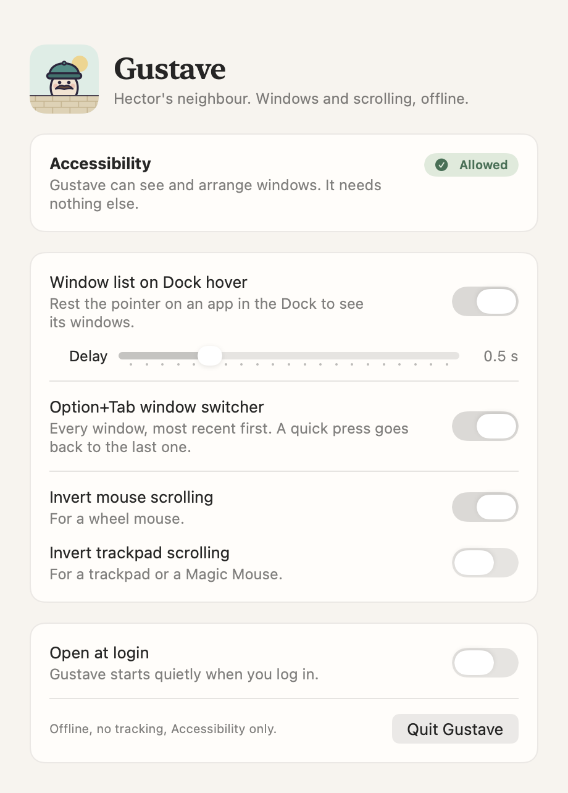

# Gustave

**The three macOS window and mouse fixes you install a heavy app for, in one tiny app that
asks for a single permission and never goes online.**

macOS makes you juggle windows and mice with half-measures. Gustave fixes that, quietly,
from login:

- **See an app's windows from the Dock.** Rest the pointer on a running app and pick the
  window you want, on any desktop.
- **Option+Tab between windows, not apps.** Windows-style: every window, most recently used
  first. A quick press goes back to the last one.
- **Scroll the way you like, per device.** Natural on the trackpad, classic on the wheel
  mouse, at the same time.

It needs Accessibility and nothing else: no Screen Recording, no Input Monitoring, no
network, no dependencies, no auto-update. Each feature is one switch, and a switch that is
off is uninstalled, not paused.

<picture>
  <source media="(prefers-color-scheme: dark)" srcset="docs/images/settings-dark.png">
  
</picture>

Status: **early, used daily by its author.** See [Known limitations](#known-limitations).

## Install

```sh
brew install --cask 0xrd/tap/gustave
```

Gustave is not notarized by Apple, so on first launch allow it in System Settings, Privacy &
Security, Open Anyway. Then grant Accessibility when it asks. Releases are signed with the
same certificate each time, so the permission carries over to updates. Prefer to build it
yourself? See [From source](#from-source).

### From source

Requires macOS 15 or later on Apple silicon, and Xcode 16 or later or the Command Line
Tools. Building with the macOS 26 SDK (Xcode 26) gives the panels Liquid Glass; older
SDKs use a rounded blur instead.

```sh
git clone https://github.com/0xRD/gustave.git
cd gustave
scripts/make-cert.sh     # once per Mac, see below
scripts/build-app.sh     # builds and signs build/Gustave.app
scripts/verify.sh        # optional: the security checks
cp -R build/Gustave.app /Applications/
open /Applications/Gustave.app
```

**Why a certificate.** macOS ties the Accessibility permission to the app's signature.
`make-cert.sh` creates a self-signed code signing certificate named "Gustave Local Signing"
in your login keychain and trusts it for code signing only (macOS asks you to confirm). Each
rebuild is then signed the same way, so the permission survives updates. Nothing leaves your
Mac.

**First run.** The settings window opens. Click Allow Access, turn Gustave on in System
Settings, Privacy & Security, Accessibility, then turn on the features you want. "Open at
login" works best from the copy in /Applications. Gustave then runs out of sight; open it
again from Finder or Spotlight to see its settings.

**Option+Tab.** If DockDoor, AltTab or another switcher also uses Option+Tab, turn its
shortcut off.

## Why Gustave

Gustave exists because the usual answers to these three itches are bigger than the itch.

**A window list on Dock hover.** The Dock shows apps, not windows. With six Chrome windows
open, clicking its icon gives you no way to say which one you mean. Apps such as DockDoor
solve this with thumbnails, which means Screen Recording, the most invasive permission
macOS has. Gustave lists window titles instead. Titles, state and the close, minimize and
full-screen buttons all come from Accessibility, so the list is just as useful for picking a
window, and nothing ever reads your screen.

**Option+Tab between windows.** Command+Tab switches apps, so two windows of the same app are
one stop and you reach the other with a detour. Windows' Alt+Tab switches
windows, with the previous one a quick press away. Gustave does the same, ordered by last use
like Command+Tab, across all your desktops, and a quick press toggles between your two
latest windows even inside one app. It uses Option+Tab so Command+Tab keeps working as usual.

**Scroll inversion per device.** macOS has one "natural scrolling" switch for both trackpad
and mouse, so you cannot have a trackpad that follows your fingers and a wheel that scrolls
the old way. The fix is usually a utility that reads input devices; Gustave only needs to
know whether an event is continuous (trackpad) or notched (wheel), which is public and
needs no extra permission. The event tap exists only while an inversion is on.

**Why one small app.** All three features need Accessibility, which lets an app read and
control other apps. That is a lot of trust to hand out, so Gustave is built to be read in
an afternoon: offline, no dependencies, no timers or polling while idle, and a script
(`scripts/verify.sh`) that fails the build if anything else sneaks in. The full reasoning,
decision by decision, is in [`docs/DECISIONS.md`](docs/DECISIONS.md).

## Privacy and private APIs

Gustave holds the Accessibility permission, so it is built to be read in an afternoon:
offline, no dependencies, every check in [`scripts/verify.sh`](scripts/verify.sh). Window
titles and app names are only shown as plain text, never logged.

Public macOS APIs cannot list or focus windows on other desktops, so Gustave uses a few
private functions, the same ones DockDoor and AltTab rely on. Each is looked up at run time;
if a macOS update removes one, Gustave still launches and that feature falls back to the
current desktop. `verify.sh` fails the build if any other private name appears.

| Function | Why |
|---|---|
| `_AXUIElementCreateWithRemoteToken`, `_AXUIElementGetWindow` | Reach windows on other desktops through Accessibility, and know their window ids |
| `CGSMainConnectionID`, `CGSCopySpacesForWindows` | Tell real windows on other desktops from hidden helper windows |
| `_SLPSSetFrontProcessWithOptions`, `SLPSPostEventRecordTo` | Bring one window forward on its own desktop, even when its app is already in front |
| `CoreDockSetAutoHideEnabled` | Only to undo an older build's change to Dock auto-hide after a crash |

They grant nothing beyond Accessibility. The reasoning for each is in
[`docs/DECISIONS.md`](docs/DECISIONS.md) (D17, D25, D26) and the threat model in
[`SECURITY.md`](SECURITY.md).

## Update

With Homebrew, `brew upgrade --cask gustave`. From source:

```sh
git pull && scripts/build-app.sh && cp -R build/Gustave.app /Applications/
```

A source build is signed with your own certificate and a Homebrew one with the project's,
so switching between them needs the Accessibility permission granted once more.

## Uninstall

1. Turn off Open at login if it is on, then quit Gustave from its settings window.
2. Delete Gustave.app (or `brew uninstall --cask gustave`).
3. Remove it from System Settings, Privacy & Security, Accessibility.
4. If you built from source, delete the "Gustave Local Signing" certificate in Keychain
   Access, login keychain.
5. Optional: `defaults delete io.github.0xrd.gustave`.

## Known limitations

- Windows on other desktops come from the private functions above. A window Gustave has
  never seen may be missing until you visit its desktop once.
- Not yet checked on device: a Dock on the left or right, several displays, Stage Manager,
  a frozen app.
- The Dock hides while the pointer is on the window list when auto-hide is on. Keeping it
  shown moves maximized windows, so Gustave does not.
- The scroll inversion event tap runs on the main thread; a busy moment there can delay a
  scroll (planned fix in [`TASKS.md`](TASKS.md), M5.0).
- A mouse whose driver sends smooth scrolling counts as a trackpad, and so does a Magic
  Mouse.

## Development

```sh
scripts/check.sh         # release build with zero warnings, unit tests
```

| Path | Purpose |
|---|---|
| `SPEC.md` | What each feature does |
| `SECURITY.md` | Threat model and verification checklist |
| `TASKS.md` | Milestones and what is still open |
| `docs/DECISIONS.md` | Every decision and what was verified on device |
| `CLAUDE.md`, `docs/KICKOFF_PROMPT.md` | Rules and workflow for Claude Code, which wrote most of the code |
| `Sources/GustaveCore` | Pure logic, unit tested |
| `Sources/Gustave` | AppKit, SwiftUI and Accessibility glue |
| `scripts/` | Signing, build, verification, quality gate and release (`release.sh`) |

## Acknowledgements

Studied, not copied: [DockDoor](https://github.com/ejbills/DockDoor) and
[AltTab](https://github.com/lwouis/alt-tab-macos) for reaching windows on other desktops,
[Hammerspoon](https://github.com/Hammerspoon/hammerspoon) and
[yabai](https://github.com/koekeishiya/yabai) for focusing a window on another desktop, and
[Scroll Reverser](https://github.com/pilotmoon/Scroll-Reverser) for scroll inversion.

## License

GPL-3.0-or-later, see [LICENSE](LICENSE).
